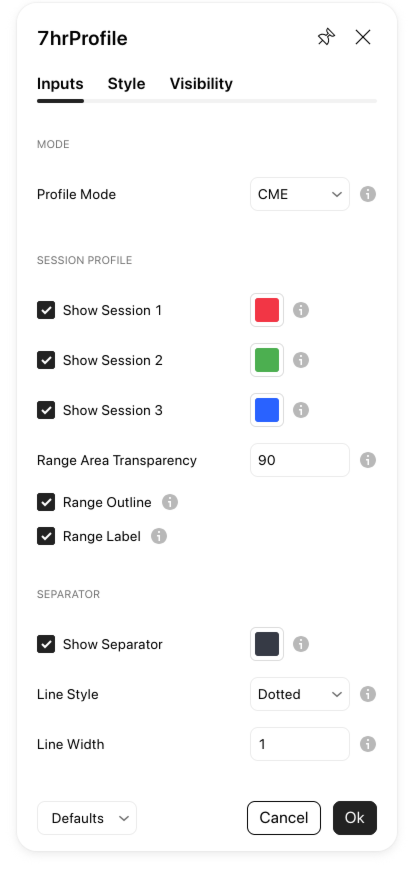
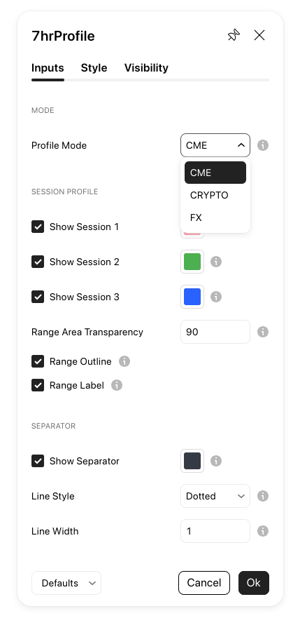
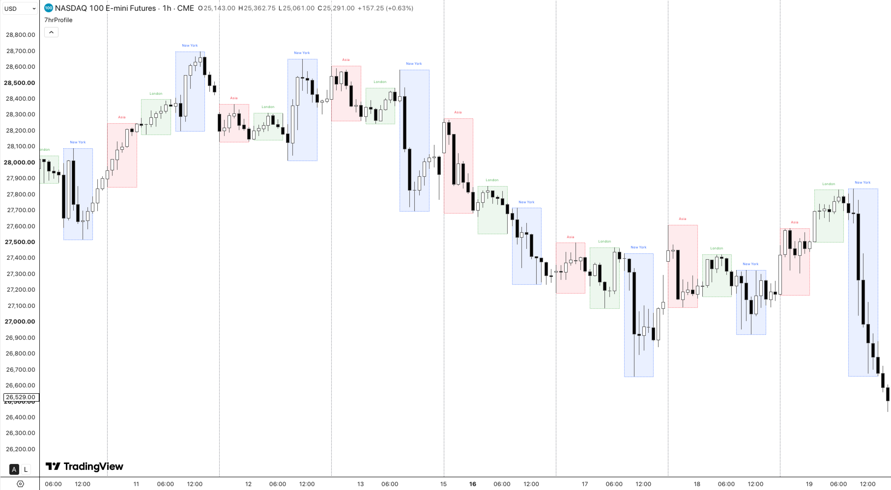
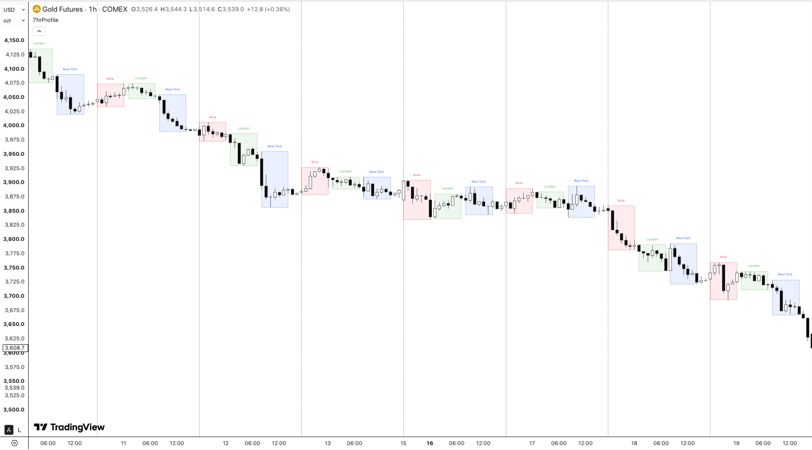
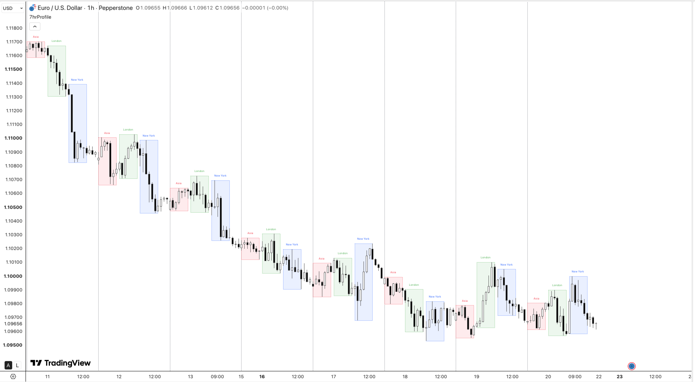

# 7hrProfile — 7-Hour Candle Profile

A TradingView (Pine Script v6) indicator that profiles the **7-hour candle** directly on your **lower-timeframe (LTF)** chart. Instead of switching to the 7h timeframe, the script boxes each 7-hour block on any intraday chart (e.g. 1m, 5m, 15m, 1h), so you can see the high/low range of each 7h candle **and** the lower-timeframe price action that formed it, all on one chart.

Each trading day is split into three 7-hour sessions, **Asia**, **London**, and **New York**. Each one is drawn as a shaded range box that grows with the session's high and low in real time. A vertical separator marks the start of each new trading day.

* * *

## Why This Indicator?

- **Profile the 7h candle without leaving your LTF.** You keep your execution timeframe and still see where each 7h candle opened, how far it ranged, and where it closed.
- **Three market modes.** The 7h candle starts at a different hour on CME futures, FX/CFD, and Crypto. Pick the mode that matches your instrument and the session boxes line up with that market's 7h candles.
- **Use any chart timezone you like.** Session times are calculated internally in **New York time (`America/New_York`)**, which switches between **EST/EDT automatically**. You can set your chart to any timezone and the boxes stay correct, with no need to reconfigure anything when daylight saving time changes.

* * *

## Installation

1. Open the [`7hrProfile.pine`](./7hrProfile.pine) file in this repo and copy the full code.
2. Go to **TradingView** (web or desktop app).
3. Open **Pine Editor** → **New indicator**.
4. Delete the placeholder template code and paste the copied script.
5. Click **Add to Chart**.

That's it, no external dependencies required.

> **Note:** The indicator only draws on **intraday (minute-based) timeframes**, e.g. 1m, 5m, 15m, 30m, 1h, 4h. Use a timeframe below 7h so each session box contains multiple candles.

* * *

## Profile Modes

All session times are in **New York time** (EST/EDT is handled automatically).

| Mode | Session 1 — Asia | Session 2 — London | Session 3 — New York | Use For |
| --- | --- | --- | --- | --- |
| **CME** | 18:00 – 01:00 | 01:00 – 08:00 | 08:00 – 15:00 | CME futures (NQ, ES, GC, CL, etc.) |
| **FX** | 17:00 – 00:00 | 00:00 – 07:00 | 07:00 – 14:00 | Forex & CFD brokers (EURUSD, GBPUSD, USDJPY CFD, etc.) |
| **CRYPTO** | 20:00 – 03:00 | 03:00 – 10:00 | 10:00 – 17:00 | Crypto pairs (BTCUSDT, ETHUSDT, etc.) |

* * *

## Settings

All inputs are configurable from the indicator's settings panel.

### Mode

| Input | Description |
| --- | --- |
| **Profile Mode** | Picks the session template used to build the three 7-hour profiles: `CME`, `CRYPTO`, or `FX`. |

### Session Profile

| Input | Description |
| --- | --- |
| **Show Session 1** | Shows or hides the Asia range box. The color swatch sets the box and label color (default: red). |
| **Show Session 2** | Shows or hides the London range box. The color swatch sets the box and label color (default: green). |
| **Show Session 3** | Shows or hides the New York range box. The color swatch sets the box and label color (default: blue). |
| **Range Area Transparency** | Transparency of the range boxes, from 0 (opaque) to 100 (invisible). Default: 90. |
| **Range Outline** | Draws a dotted outline around each range box. |
| **Range Label** | Shows the session name (Asia / London / New York) above each range box. |

### Separator

| Input | Description |
| --- | --- |
| **Show Separator** | Draws a vertical line at the start of each new trading day. The color swatch sets the line color. |
| **Line Style** | Sets the line style to Dotted, Solid, or Dashed. |
| **Line Width** | Sets the separator line thickness from 1 to 5. |

* * *

## Examples

### NQ — CME Mode

NASDAQ 100 E-mini Futures on the 1h chart. Each trading day is split into Asia, London, and New York 7-hour profiles, with dotted separators marking each new day.

### GC — CME Mode

Gold Futures (COMEX) on the 1h chart using the same CME session template.

### EURUSD — FX Mode

EURUSD on a CFD broker (Pepperstone) on the 1h chart. The FX template starts at 17:00 New York time, matching the FX/CFD 7h candle open.

* * *

## License

MIT License — © MadMataTrader. See [`LICENSE`](./LICENSE) for details.
